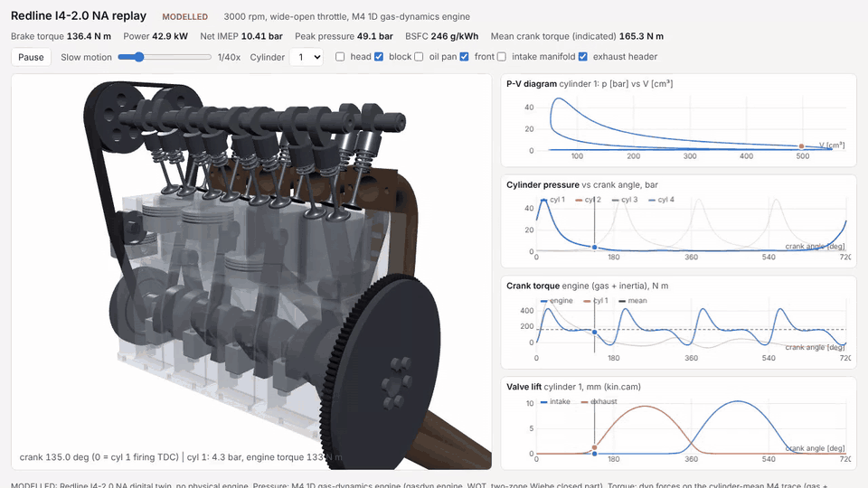
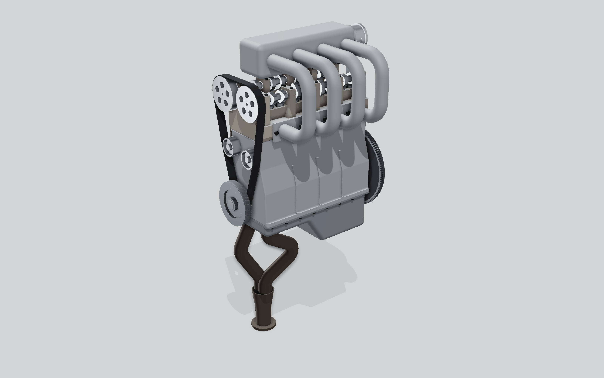
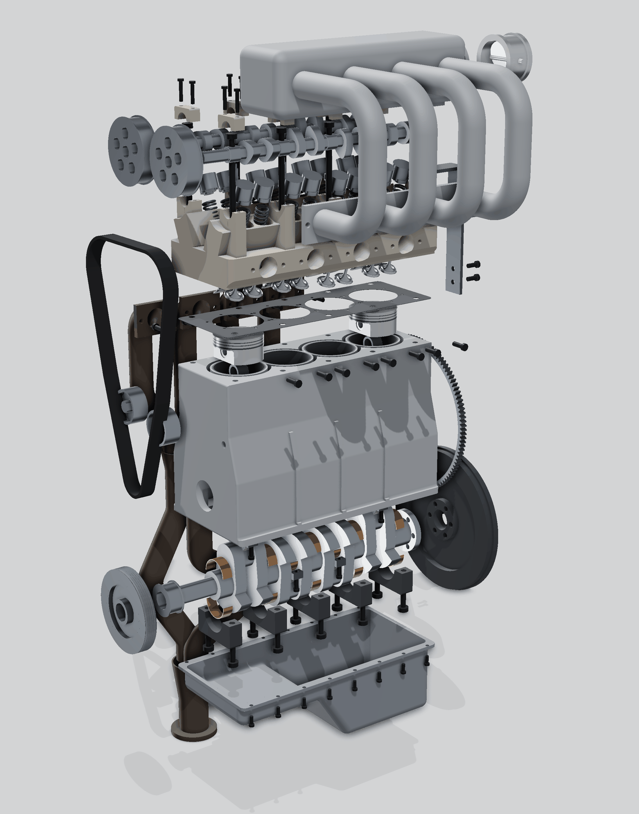
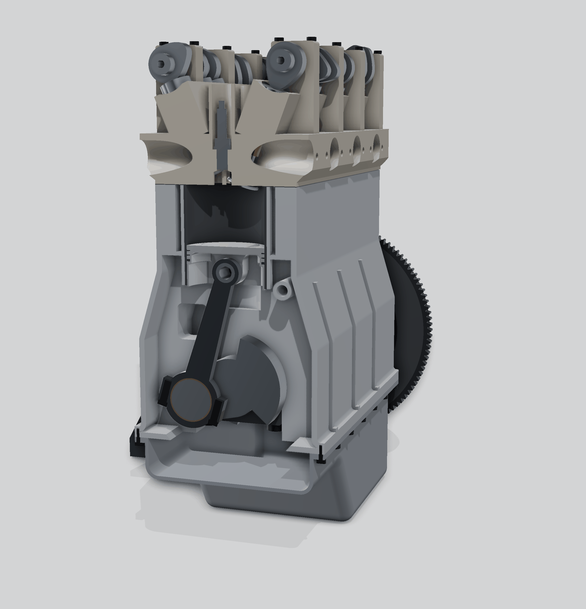
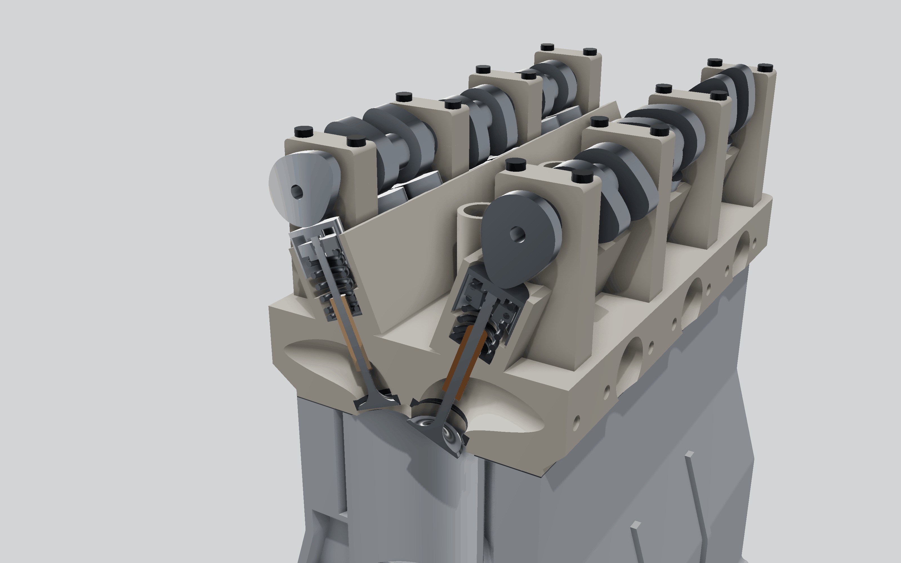

# Redline

A code-first digital twin of a 2.0 L naturally aspirated inline-4: parametric CAD (build123d),
crank-angle thermodynamics and combustion (Cantera), 1D gas dynamics, kinematics, dynamics and NVH,
structural FEA, and an engine control unit that runs hardware-in-the-loop on the Vortex-V RISC-V core.

All numbers are **modelled**. Plan: see `docs/PLAN.md`.

## Gallery



*The three.js replay (`viz/replay/index.html`) at 3000 rpm, wide-open throttle. It shows the CAD crank train moving with exact slider-crank kinematics, next to cylinder 1's P-V loop, the four cylinder pressures, crank torque and valve lift. Pressures come from the M4 1D gas-dynamics engine. **All numbers are modelled**; there is no physical engine. Recorded headless with `node viz/record_demo.mjs`. [MP4](docs/media/replay.mp4)*

| | |
|---|---|
|  |  |
|  |  |

*CAD renders from `cad/` (build123d). The interference audit is in [docs/CAD-AUDIT.md](docs/CAD-AUDIT.md).*

## Quick start
```
pip install -r requirements.txt
pytest -q
```

## Vehicle, replay and report (M10)
```
python -m vehicle.wltp                 # WLTP Class 3b L/100 km and g CO2/km (generic compact sedan, spec/vehicle.yaml)
python -m vehicle.accel                # 0-100 km/h and 80-120 km/h in gear
python -m vehicle.wot_fixture          # regenerate fixtures/wot/wot_coarse.csv from the M4 model (reviewed change)
python -m dyn.report --pressure m4     # M5 dynamics on real M4 / thermo pressure traces, vs the placeholder
python -m viz.build --check            # three.js replay viz/replay/index.html + headless check (node playwright)
python -m report.build                 # docs/REPORT.md technical report, figures under out/
pytest -q tests/test_m10_vehicle.py tests/test_m5_dynamics.py
```
The technical report is `docs/REPORT.md`; every number in it is computed by `report/build.py` and is modelled.
